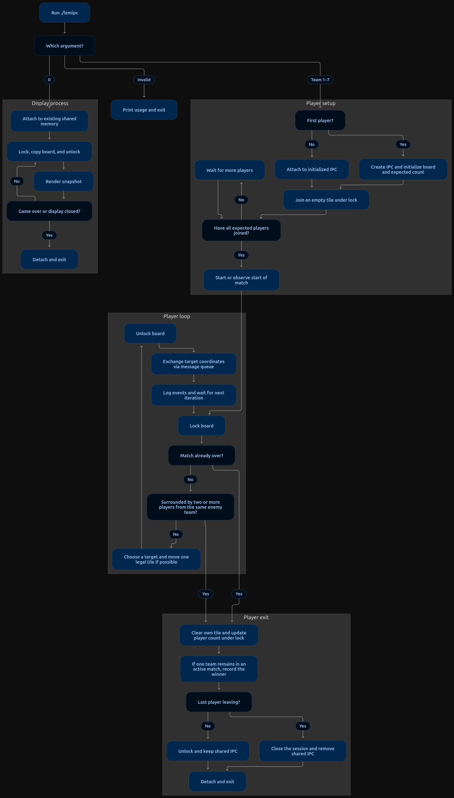

# lem-ipc

A 42 project in which each player runs in its own process. Players share a board through System V shared memory and coordinate through a semaphore and a message queue.

## Run a match

**Linux only.** `lemipc` uses `semtimedop()` for semaphore waits and `/proc/<pid>/stat` to identify running player processes.

Build with `make`.

**Run every process of a match from the same working directory.** The session key comes from `ftok(".")`, so the directory is the game: players started in another directory join a different session, and the display finds no session at all.

```sh
./lemipc <team>    # join as a player of <team>
./lemipc 0         # open a terminal view of the running session
```

| Input | Accepted values |
| --- | --- |
| `<team>` | Any positive number from `1` to `2147483647` (`INT_MAX`). Signs, spaces, trailing characters, and larger numbers are rejected. |
| `0` | Display only. It never creates the board and never changes it. |
| `LEMIPC_PLAYERS` | Roster size read by the first player, `2`–`400`, default `4`. The match starts once that many players have joined. |

```sh
LEMIPC_PLAYERS=3 ./lemipc 1 &
./lemipc 1 &
./lemipc 2 &
./lemipc 0
wait
```

When you use a custom roster size, start the first command and wait for its join message before you start the others, because only the first player reads `LEMIPC_PLAYERS`. Use Ctrl-C to close the display or to withdraw a player running in the foreground.

## Make targets

`make help` prints the same list, grouped the same way. `make help T=<target>` prints the details of one target, like a command's `--help`: its variables, what it checks, and examples (for instance `make help T=demo`). The text lives in `#>` lines right above each rule in the Makefile.

**Build**

| Target | What it does |
| --- | --- |
| `make` / `make all` | Build `lemipc` with libft. A second run rebuilds nothing. |
| `make clean` | Remove object files, test binaries, and `ipc_probe`. |
| `make fclean` | `clean`, plus `lemipc` and the libft archives. |
| `make re` | `fclean`, then build again. |

**Tests**

| Target | What it does | Time |
| --- | --- | --- |
| `make test` | `unit` + `integration` | about 2–3 min |
| `make unit` | Six unit suites: rules, roster, movement, config, IPC, IPC lifecycle | seconds |
| `make ipc-test` | Only the IPC unit suite: creation failures and team target messages | seconds |
| `make integration` | Real processes over real System V IPC | about 2 min |
| `make stress` | 400 players in 7 teams, plus semaphore lock recovery. Not part of `make test`. | seconds |

**Evaluation scenarios**

| Target | What it does |
| --- | --- |
| `make eval-list` | Name and expected result of each scenario |
| `make eval` | All eight scenarios, with Valgrind |
| `make eval SCENARIO=<name>` | One scenario. Add `VERBOSE=1` for full logs. |

Scenarios: `normal-win`, `sigint-withdrawal`, `sigint-running`, `sigkill-survivor`, `all-killed-recovery`, `display-last`, `large-teams`, `one-on-one-stalemate`. Each one reruns a test from `make integration` and reports Game, Memory, and IPC results for the evaluator.

**Demos and inspection**

| Target | What it does |
| --- | --- |
| `make demo [NTEAMS=2-7] [KILL=1]` | Two-terminal demo with `NTEAMS` teams of two players (default 2). `KILL=1` sends SIGKILL to one team 2 player during the match and shows recovery. See below. |
| `make play [TEAMS="..."]` | One background player per entry (default `1 1 2 2`), board on screen, logs in `logs/` |
| `make ipcs` | IPC objects owned by this user, with their role. Read only. |
| `make help [T=<target>]` | This list, or the details of one target |

`clean`, `fclean`, and `re` never touch IPC objects, and no target removes them for you, so a leak stays visible to `ipcs`.

`make play` starts one background player for each entry in `TEAMS`, sets `LEMIPC_PLAYERS` to the number of entries, and shows the board in the foreground. Ctrl-C asks every player to leave, and the last one removes the IPC objects. Team ids are checked by `./lemipc` itself: if it rejects one, or if not every player joins within 5 seconds plus 0.1 second per player, `make play` asks the started players to leave and exits with status 1. Player logs are named by launch order (`logs/player-1.log`, ...).

## Rules

Players check for elimination before each turn. They move one tile up, down, left, or right when a legal move is available, with one second between turns. A tile holds at most one player. A player is eliminated when at least two adjacent players belong to the same opposing team. Diagonal neighbors count for elimination. Teammates exchange target coordinates through the message queue, and the last team remaining wins.

## Limits

The FAQ in `faq.txt` is part of the subject, and it sets no limit on players or teams.

- **Players:** at most 400. The board is 20×20 (`BOARD_SIZE` in `inc/lemipc.h`), and the FAQ leaves the board size to the implementation. The roster is checked against the board's cells.
- **Teams:** no fixed limit. A team id is any `int` above zero, and nothing is indexed by team id. At most 400 teams can be on the board at once, since each team needs at least one player.
- **Display:** teams 1–9 draw one character per tile. When a team id with more digits is on the board, every tile widens to fit it. `make eval SCENARIO=large-teams` plays teams 8 and 42.
- **Stalemates:** an elimination needs two players of the same team. A one-on-one match, or a board where every team has a single player, can therefore never end. This follows from the subject's rules. Demos use at least two players per team, and `make eval SCENARIO=one-on-one-stalemate` shows the one-on-one case.

## Two-terminal demo

1. In the right terminal, run `make demo` from the repository for two teams.
   Use `make demo NTEAMS=3` up to `NTEAMS=7` for more teams. Each team has
   two players.
2. In the left terminal, run `./lemipc 0` from the same repository directory,
   or paste the full command printed by the demo.
3. When the board shows one player waiting, press Enter in the right terminal
   to launch the remaining players. Watch the board on the left and the
   joins, eliminations, and winner on the right. Press Ctrl-C in the left
   terminal to close the board when you finish.

The right terminal also prints the session's message queue ID and reports
when the kernel records a successful send and receive by demo players.
For a separate check of team-specific target messages, run
`make ipc-test`.

The demo uses the repository directory for its game session. Close any existing
session in that directory before starting the demo.

To demonstrate recovery after a player is killed, run `make demo KILL=1` in
the right terminal (it combines with `NTEAMS`) and open the same board on the
left. Press Enter to start the
match, then press Enter again at the SIGKILL prompt to kill the indicated
Team 2 player. Watch the remaining players on the left. The right terminal
reports the winner and checks that the session's three IPC IDs are gone.

## Tests

The commands are listed under [Make targets](#make-targets).

`make unit` links the core objects from `obj/src/` without `main.o`, so the suites call
`is_surrounded`, `join_player`, `leave_player`, `move_player`,
`choose_target` and `parse_team` directly on a plain `t_board`. The movement
suite checks forced moves and runs 400000 random move attempts. After every
attempt it checks that each step was one orthogonal tile and that the board
still holds exactly one player per occupied tile; a separate check confirms
that this invariant test catches two players sharing a tile. The IPC suite uses private IPC objects and GNU linker
wrapping to inject failures during session creation. It also checks empty and
full message queues and team-specific target exchange.

`make integration` starts real matches. Every test runs in its own fresh
directory, because the session key comes from `ftok(".")` and a new directory
therefore means a new session. The harness waits for its own child processes
and checks their exit codes. It records the IPC IDs from each match's board
and removes any of those objects that survive the match.

The integration suite checks IPC cleanup after `SIGINT` (both while waiting
for the roster and during a running 2 vs 2 match), after a player is
killed during a match, after the display exits last, and when a new run
replaces a session whose last process was killed. It also plays a match
between teams 8 and 42 to cover team ids beyond one digit, and checks that a
one-on-one match keeps going until Ctrl-C. When Valgrind is
installed, it checks all players in a normal match and the survivor in the
in-progress `SIGKILL` test. Evaluation reports process exits, Valgrind checks,
and the outcome for each kernel IPC object. The recovery scenario kills
players after the session is initialized and play has started.

`make stress` starts 400 player processes in a separate session, with 58 in
team 1 and 57 in each other team. It checks the roster and looks for a move
or elimination, with up to 30 seconds for each stage. It then sends SIGINT
and checks that all children are reaped within 15 seconds and the session's
SHM, SEM, and MSGQ are gone. The IPC lifecycle suite separately checks
semaphore recovery by checking that a blocked waiter acquires the lock after
the owner is killed. Valgrind checks the first player from each team (7 of
400) for memory errors and definite, indirect, and possible leaks. The
memory check reports `SKIP` if Valgrind is unavailable. Use `VERBOSE=1`
for Valgrind logs and lifecycle test details.

All 400 players join within a few seconds, and the whole run usually takes
about two seconds. Players waiting for the roster lock the board every 100 ms
but do not reap dead players: reaping reads `/proc` for every slot while
holding the lock, and when every waiting player did it on every poll, late
joiners starved and 400 joins took 30–40 seconds. A joiner still reaps once
in `run_player` before taking a slot, and every turn reaps once the match is
running, so a player killed while waiting is still removed.

### Shared output

`ft_printf` issues one `write(2)` per byte, so players sharing a terminal
used to interleave mid-word when they printed in the same instant. Player
messages now go through `announce()`, which formats the whole line first and
prints it with a single `write()`. The integration test
`player_lines_never_garbled` starts every player at once on one file
descriptor, which is the case that used to fail, and checks every line.

## Source layout

| Module | Responsibility |
| --- | --- |
| `main.c`, `config.c` | Command-line dispatch, team and roster parsing, and signal handling |
| `session.c`, `resources.c` | Session discovery, synchronized initialization, board locking, and IPC removal |
| `player.c`, `roster.c` | Joining, waiting for the roster, taking turns, and leaving |
| `movement.c`, `capture.c`, `target.c` | Legal steps, elimination, and team targeting |
| `announce.c`, `liveness.c` | One-write output lines, and detecting dead or reused player PIDs |
| `display.c` | Copy the board under lock and render the snapshot after unlocking |
| `tests/` | Unit suites on a plain board, plus an integration suite over real IPC |

## Code flow

Click the diagram to open it at full resolution.

[](flow-chart.png)

## Semaphore and IPC recovery

The directory lock serializes session creation, attachment, and cleanup.
The System V semaphore starts at 1 and serializes access to the shared board.
A player acquires it with `-1` and releases it with `+1`, both using
`SEM_UNDO`. On normal release the adjustments cancel. If a process exits
while holding the lock, the kernel applies its outstanding adjustment so
another process can acquire the semaphore. [Linux semop(2)](https://man7.org/linux/man-pages/man2/semop.2.html)

`SEM_UNDO` records semaphore adjustments only. Shared-memory writes are
ordinary memory operations, and the kernel has no record of which writes
belong to one game move. If `SIGKILL` arrives between writing the destination
tile and updating the player's recorded position, the lock becomes available
while the board can still contain a partial move. Recovering that state
requires application-level logic. [Linux semop(2)](https://man7.org/linux/man-pages/man2/semop.2.html) · [Linux signal(7)](https://man7.org/linux/man-pages/man7/signal.7.html)

The last process attached to the board, including the display, removes the
message queue, semaphore, and shared-memory segment when it exits through
the normal cleanup path. If every attached process is killed, the next
player started in the same directory reclaims the abandoned session.
A segment with an incompatible board size is rejected with `EINVAL`.

During play, surviving players remove slots whose recorded PIDs no longer
exist. A killed process can still appear to exist while it is a zombie, until
its parent reaps it. The display checks its local snapshot and closes once all
players recorded in that snapshot are gone.

The semaphore, message queue, and shared-memory segment use the same
`ftok(".", 'L')` key. If initialization is interrupted by `SIGKILL`, the
next player can use that key to remove a leftover semaphore and message
queue even if the shared-memory segment was never created or its header
was never written.
